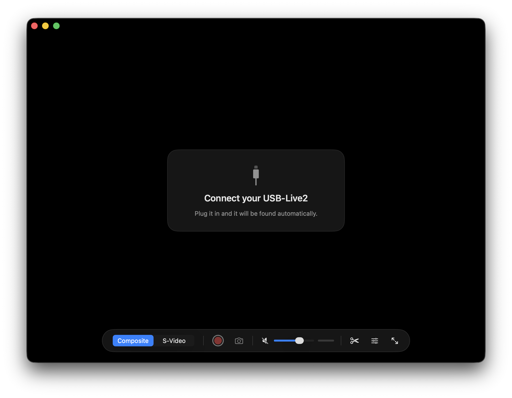

# USB-Live2 for Mac

A native Mac app for the **Hauppauge USB-Live2** (USB ID 2040:c200), made
for digitizing VHS, Hi8 and other analog tapes. It works on Apple Silicon
with no Hauppauge driver, and supports the USB-Live2 only. It runs in
userspace on top of libusb.

The hardware programming is the Linux kernel's `cx231xx` and `cx25840` driver
code, copied verbatim and called in the same order Linux calls it. A small
compatibility layer maps kernel APIs onto libusb.

## Features

The video fills the window, with a floating control bar
that fades out when the pointer is idle.

- Composite / S-Video switch (⌘1 / ⌘2)
- Record to MP4 with sound (⌘R), saved to Movies
- Snapshot to PNG (⇧⌘S), saved to Pictures
- Volume, mute (⌥⌘M), audio level meter
- Settings: brightness, contrast, saturation, hue; deinterlace Off / Blend /
  Smooth (60 fps); crop edges; NTSC / PAL
- Detects the device automatically when it is plugged in
- Double-click or ⌃⌘F for full screen

Settings are remembered between launches.

**Long recordings:** while recording, the app keeps your Mac from going to
sleep, and recording continues if you minimize the window or the screen
turns off. On a MacBook, keep the lid open and the power plugged in, and
press stop before quitting the app.

**Edit Recording** (scissors button, or ⇧⌘E) opens an editor window:

- Timeline with thumbnails and separate L/R audio waveforms, zoom up to 16×
- Drag across the timeline (or press I and O) to select a section in yellow;
  Delete cuts it out and the parts on either side join with a hard cut.
  Handles and −/+ buttons adjust the selection frame by frame
- Change any join to a Crossfade or Fade to Black; optional fade in/out
- Drag parts by their bar to rearrange them; S splits at the playhead
- One timeline: deleted parts come off it completely and the rest closes up
- Undo / Redo (⌘Z / ⇧⌘Z)
- Crop the picture; fix audio (Left → Both, Right → Both, Mix to Mono)
- Export to a new MP4 wherever you choose; the original is never changed

## What you need

- A Mac with Apple Silicon and macOS 14 or later
- A Hauppauge USB-Live2, with both the video cable (yellow composite or
  S-Video) and the red and white audio cables plugged in. Without the audio
  cables, recordings are silent.
- The USB-Live2 has a USB-A plug. It has been tested through a USB-C hub on
  a Mac with only USB-C ports. A plain USB-C to USB-A adapter should work
  the same way but hasn't been tested yet.
- NTSC tapes (US, Canada, Japan) are tested. PAL (Europe, Australia) is
  supported in Settings but untested.

## Download

Get `USB-Live2.zip` from the Releases page, unzip it and drag the app into
Applications. It needs two free tools from Homebrew (https://brew.sh):

    brew install libusb ffmpeg

The app isn't notarized by Apple, so macOS may say it can't be opened or is
damaged. To allow it, run this once in Terminal:

    xattr -dr com.apple.quarantine /Applications/USB-Live2.app

## Troubleshooting

- **"Connect your USB-Live2" stays on screen:** unplug the USB-Live2 and
  plug it back in, or try another port or hub.
- **No Signal or a black picture:** switch between Composite and S-Video to
  match the cable you used, check NTSC / PAL in Settings, and make sure the
  tape is playing.
- **No sound:** check the red and white audio cables. The app starts muted
  on purpose to avoid loud feedback; unmute it to listen. Recordings include
  sound even while muted.
- **A date or time flashing on the picture:** it was recorded onto the tape
  by the camcorder, so it can't be removed. Turn off the camera's date
  display for future recordings.

## Building from source

Needs Apple's Command Line Tools and Homebrew:

    xcode-select --install
    brew install libusb pkg-config ffmpeg
    make app
    open USB-Live2.app        # or drag it into Applications

## Older tools (SDL viewer and command line)

    brew install libusb pkg-config sdl2 ffmpeg
    make

## Viewer app

    ./usblive2_viewer                     # composite, NTSC
    ./usblive2_viewer --input svideo      # or --pal, --bulk, --no-deinterlace, --no-audio, --mute

| Key | Action |
|---|---|
| R | start / stop recording (MP4: H.264 via Apple's hardware encoder + AAC audio) to ~/Movies |
| M | mute / unmute live audio (recordings always include audio) |
| I | switch input: composite / S-Video |
| D | deinterlace on/off (preview: blend; recording: yadif, applied at record start) |
| F or double-click | fullscreen (Esc leaves fullscreen) |
| S | snapshot (BMP) to ~/Pictures |
| Q / Esc | quit |

The window title shows the input, the detected signal (or NO SIGNAL), fps
and recording time.

## Command-line test tool

    ./usblive2_capture                    # composite input, NTSC, 5 seconds

The program saves `usblive2_frame_1.bmp` … `_3.bmp` snapshots into the
current folder.

Options:

    --input svideo        use the S-Video input (default: composite)
    --pal                 PAL instead of NTSC
    --seconds N           capture length (default 5)
    --snapshots N         number of BMP snapshots (default 3)
    --raw out.yuv         also write every frame as raw YUYV 4:2:2
    --wav out.wav         also write the audio (48 kHz stereo) to a WAV file
    --no-audio            video only
    --bulk                use bulk instead of isochronous USB transfers
    -v / -vv              driver log / log every USB register access

## Layout

| Path | What it is |
|---|---|
| `linux/` | Untouched upstream source files (commit in `linux/SOURCE_COMMIT.txt`) |
| `gen/` | Generated by `tools/gen.py`: upstream files with kernel `#include`s removed, and upstream functions copied byte-for-byte by `tools/extract.py`. Each copy is marked with its upstream file:line. |
| `kstubs.h` | Minimal kernel API shim (types, logging, lists, msleep, ...) |
| `glue.c` | `usb_control_msg` / `usb_set_interface` on libusb, the I2C core bits |
| `ul2.c` / `ul2.h` | Capture core: probe → init → open → stream, mirroring the Linux driver (video: cx231xx-video.c, audio: cx231xx-audio.c) |
| `mac/` | The SwiftUI app: window/UI, display layer, audio output, app icon |
| `engine.c` / `engine.h` | Engine for the app: capture thread, crop, deinterlace, audio ring buffer, recording |
| `usblive2_viewer.c` | Simple SDL2 viewer (older) |
| `recorder.c` | Non-blocking MP4 recording through ffmpeg pipes, A/V sync on the audio clock |
| `usblive2_capture.c` | Command-line test tool |
| `tests/mock_libusb.c` | Simulated USB-Live2 for testing without hardware (`make mocktest`) |

The only change to upstream logic is PATCH 1 in `tools/gen.py`. It skips the
cx231xx audio-DSP firmware load, which is only needed for TV-tuner audio.

## Made with AI

This project was written with the help of AI: Claude by Anthropic (Claude
Opus 5.5). It was tested by a person on real hardware, a USB-Live2 with a
Sony CCD-TRV66 camcorder.

## Disclaimer

This is an independent project. It is not affiliated with or endorsed by
Hauppauge. "Hauppauge" and "USB-Live2" are used only to say which device it
works with.

## License

GPL-2.0-or-later, the same license as the Linux driver it is derived from
(see LICENSE).
